# Лабораторная работа №1 — Регрессия нейросетями

**Датасет:** NASA PCoE Battery Dataset (34 батареи)

| | |
|---|---|
| Дисциплина | Машинное обучение: регрессия |
| Автор | студент |
| Дата | 23 сентября 2026 г. |
| Инструменты | Python 3.13, Keras/TensorFlow, scikit-learn, pandas, matplotlib, seaborn |

**Задача.** Одной MLP-архитектурой решить три задачи регрессии по циклам заряда/разряда
литий-ионных батарей: остаточный ресурс (RUL), напряжение следующего цикла, ёмкость
следующего цикла. Сплит строго по батареям, оценка — MAE / RMSE / R² на тесте.

## 2. Постановка задачи

**Регрессия** предсказывает непрерывную величину по набору признаков (в отличие от
классификации, где предсказывается класс). Здесь один пайплайн строит три модели:

| № | задача | цель | единица | батарей |
|---|--------|------|---------|---------|
| A | RUL | нормированная доля остаточного ресурса `RUL_frac` | доли (0–1) | 8 |
| B | напряжение | напряжение следующего цикла (`voltage_mean_next`) | В | 34 |
| C | ёмкость | ёмкость следующего цикла (`capacity_next`) | Ahr | 33* |

**Примечание:** в датасете 34 батареи, но датасет C после честного `dropna` по цели и признакам содержит 33:
у B0052 всего 4 discharge-цикла, для неё не набирается строка ни с одним полным лагом.

Задач три, потому что: (1) это покрывает формулировку «прогнозирование числовых
параметров», (2) полную кривую деградации (значит, осмысленный RUL) имеют только
8 из 34 батарей, все 34 полезны для напряжения и ёмкости.

## 3. Данные

**Источник:** NASA PCoE Battery (файлы `data/raw/*.mat`, B0005–B0056). Каждый файл —
журнал циклов charge / discharge / impedance: напряжение, ток, температура, ёмкость.

Для классификации кривой деградации вводится виртуальный порог останова
EOL = 0.7 · cap0 (cap0 — начальная ёмкость батареи):

| категория | кол-во | примеры | роль |
|-----------|--------|---------|------|
| полная кривая деградации | 8 | B0005, B0006, B0018, B0045–B0048, B0053 | RUL + B + C |
| censored (без EOL) | 12 | B0007, B0025–B0028, B0029–B0032, B0038 | B, C |
| аномальные (резкие/мусорные падения) | 11 | B0033, B0034, B0036, B0039, B0041, B0050–B0052, B0054–B0056 | B, C |
| короткие (быстрый EOL) | 3 | B0042–B0044 | B, C |

Для RUL остаются только 8 батарей с полной длинной кривой: censored не имеют EOL,
аномальные падают почти сразу, у коротких слишком мало полезных циклов.

## 4. Методология

### 4.1. Теоретическая основа

**Многослойный персептрон (MLP).**
Модель — сеть с прямой передачей сигнала: входной слой, скрытые слои,
выходной слой. Каждый нейрон вычисляет взвешенную сумму входов и применяет
функцию активации. В работе используется ReLU в скрытых слоях и линейный
выход для регрессии.

**Метод обратного распространения ошибки.**
Обучение сети состоит из двух проходов:
(1) прямой проход — вычисление выхода сети;
(2) обратный проход — вычисление градиента ошибки по весам
через цепное правило. Градиент распространяется от выходного слоя
к входному.

**Функции ошибок.**
Для регрессии используются: 
MSE = (1/n) · Σ(yᵢ − ŷᵢ)² — средняя квадратичная ошибка (функция потерь); 
MAE = (1/n) · Σ|yᵢ − ŷᵢ| — средняя абсолютная ошибка (метрика качества). 
MSE сильнее штрафует большие ошибки, MAE — устойчивее к выбросам.
В работе MSE используется как функция потерь, MAE — как метрика качества.

**Градиентный спуск.**
Веса обновляются по правилу: 
w(t+1) = w(t) − α · ∂E/∂w, 
где α — скорость обучения, ∂E/∂w — градиент ошибки по весу.
В работе используется оптимизатор **Adam** — современная реализация
градиентного спуска с моментом и адаптивным шагом.

**Нормализация входов.**
Признаки приводятся к единому масштабу: 
xᵢ' = (xᵢ − x̄) / σᵢ, 
где x̄ — среднее, σᵢ — стандартное отклонение. Это ускоряет обучение
и стабилизирует градиентный спуск. В работе используется StandardScaler,
обученный только на train.

**Регуляризация.**
Для борьбы с переобучением используются Dropout (случайное отключение
нейронов при обучении) и EarlyStopping (остановка при отсутствии улучшения
на валидации).

### 4.2. Признаки задач

На вход сети подаются только физические признаки цикла: статистики измерений
одного цикла, их производные и лаги. Метаданные батареи (идентификатор, дата,
номер строки) и длина серии нужны для группировки, сортировки и построения цели,
но в признаки не входят.

| задача | число признаков | `feature_cols` |
|--------|-----------------|----------------|
| A: RUL_frac | 14 | `voltage_mean`, `voltage_min`, `voltage_max`, `voltage_std`, `current_mean`, `temp_mean`, `temp_min`, `temp_max`, `temp_range`, `time_total`, `capacity`, `capacity_ratio`, `voltage_range`, `discharge_rate` |
| B: Напряжение | 13 | `voltage_mean`, `voltage_min`, `voltage_max`, `voltage_std`, `current_mean`, `temp_mean`, `temp_max`, `capacity`, `capacity_ratio`, `voltage_mean_lag1`, `voltage_mean_lag2`, `capacity_lag1`, `voltage_diff` |
| C: Ёмкость | 10 | `capacity`, `capacity_ratio`, `voltage_mean`, `current_mean`, `temp_mean`, `capacity_lag1`, `capacity_lag2`, `capacity_lag3`, `capacity_diff`, `capacity_slope` |

Лаги построены сдвигом назад (`shift(+1)`, `shift(+2)`, `shift(+3)`), то есть
собираются только по **прошлым** циклам. Значение следующего цикла
(`voltage_mean_next`, `capacity_next`) используется исключительно как цель
обучения — признака из будущего в сеть не попадает.

### 4.3. Пайплайн

1. **Парсинг .mat** — журнал циклов превращается в таблицу discharge-циклов
   (одна строка = один цикл, агрегированные статистики измерений цикла).
2. **Чистка** — удаляются только физически невозможные значения (ёмкость вне
   [0, 2.6], отрицательные напряжения, импедансы вне [0, 1]); субпороговые
   (ниже 0.5 Ahr) ёмкости сохраняются, т.к. это реальные данные деградации.
3. **Признаки цикла** — измерения цикла + лаги (`voltage_mean_lag1/lag2`,
   `capacity_lag1/lag2/lag3`) + производные (`voltage_diff`, `capacity_diff`,
   `capacity_slope`, `discharge_rate`) + нормированная ёмкость
   `capacity_ratio = capacity / cap0`, где `cap0` — медиана ёмкостей первых
   стабильных циклов (3–8) батареи. Дополнительно считается длина серии —
   она нужна только для нормировки цели RUL.
4. **Цели**:
   - A: `RUL_cycles` — остаток в циклах (длина серии минус номер цикла), цель
     обучения — нормированная доля `RUL_frac = RUL_cycles / total_cycles` (0–1);
   - B: `voltage_mean_next = voltage_mean.shift(-1)`;
   - C: `capacity_next = capacity.shift(-1)`.
5. **Архитектура (общий MLP-шаблон для всех задач):** входы различаются
   (`Input(14)` / `Input(13)` / `Input(10)`), скрытая часть общая:
   `Dense(64, relu) → Dropout(0.2) → Dense(32, relu) → Dense(1)`.
   Loss = MSE, метрика = MAE, EarlyStopping(patience=10,
   restore_best_weights=True), ≤ 200 эпох, Adam(1e-3), batch = 32, seed = 42.
   Для модели RUL: **3073** параметра; для напряжения — 3009, для ёмкости — 2817.
6. **Препроцессинг:** SimpleImputer(median) + StandardScaler, обучение только
   на train.
7. **Сплит строго по батареям:** GroupShuffleSplit(test_size=0.25, random_state=42)
   применяется дважды → train / val / test; пересечение групп исключено.

## 5. Результаты

### 5.1. RUL_frac (8 батарей)

Тест: 240 строк, 2 батареи
(B0006, B0047).
Per-battery MAE_frac: B0006 = 0.094, B0047 = 0.143.

| метрика | значение | оценка |
|---|---|---|
| MAE_frac | 0.108867 | в пределах ориентира 0.05–0.15 |
| RMSE_frac | 0.129426 | близко к MAE |
| R²_frac | 0.802316 | сильная объяснённая дисперсия |
| MAE_cycles ≈ MAE_frac × средняя длина серии теста | 13.0 циклов | для интерпретации |

Средняя длина серии тестовых батарей = 119.0
(B0006 = 167, B0047 = 71). Почему цель нормирована на длину серии — в 7.1.

**Что на графике.** По оси X — истинное значение RUL_frac (0–1),
по оси Y — предсказанное. Каждая точка — один discharge-цикл тестовой батареи.
Пунктирная линия — идеальное совпадение (y = x). Вывод: точки лежат
вокруг диагонали, модель объясняет форму кривой деградации.

<figure>
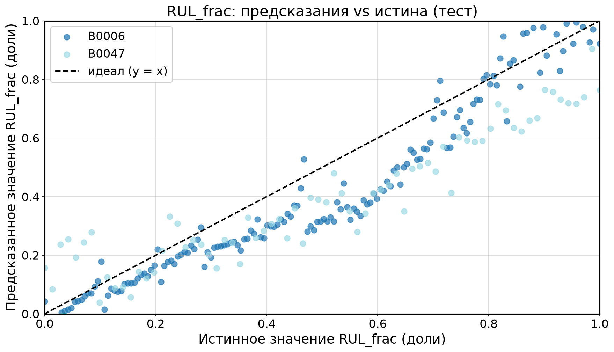
<figcaption>Рис. 5.1 — RUL_frac: предсказанные vs истинные доли (тест)</figcaption>
</figure>

**Что на графике.** По оси X — истинное значение RUL_frac,
по оси Y — остаток (предсказание − истина). Пунктирная линия y = 0 —
идеальный случай. Вывод: остатки распределены вокруг нуля без выраженной
структуры, модель адекватна.

<figure>
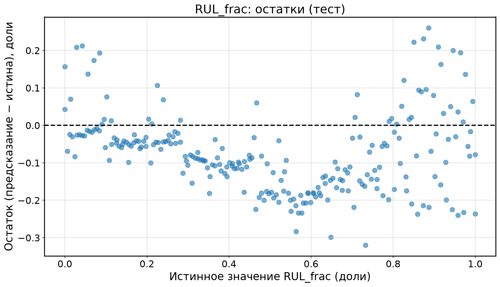
<figcaption>Рис. 5.2 — Остатки модели RUL_frac (тест)</figcaption>
</figure>

**Что на графике.** Одна и та же модель в двух единицах измерения остаточного
ресурса: слева — нормированная доля (0–1), справа — та же величина,
пересчитанная в циклы (RUL_frac · длина серии) против истинного `RUL_cycles`.
Пунктир — идеал. Вывод: в циклах ошибка составляет около
13.0 цикла на цикл, то есть оценка в долях читается
тем же качеством, но в других единицах.

<figure>
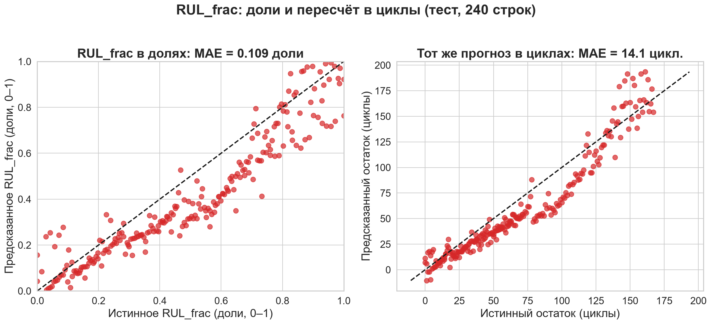
<figcaption>Рис. 5.3 — RUL_frac в долях (слева) и в пересчёте на циклы (справа)
на одном тестовом сплите</figcaption>
</figure>

### 5.2. Напряжение (34 батареи)

| метрика | значение | оценка |
|---|---|---|
| MAE | 0.156747 | ошибка удерживается в пределах 0.06–0.25 В на обычных батареях |
| RMSE | 0.259169 | усиливается вкладом выбросов |
| R² | 0.048058 | низкий; на результат сильно влияет B0050 |

Тест: 696 строк, 9 батарей.
Худшая батарея теста — B0050 (MAE 1.103 В против
0.06–0.25 В у остальных); без неё ошибка заметно ниже,
поэтому агрегированные MAE и низкий R² не отражают качество на основной части
батарей. Подробное сравнение с простыми моделями — в 5.4.

**Что на графике.** По оси X — истинное напряжение следующего цикла (В),
по оси Y — предсказанное. Цвет — батареи теста, пунктир — идеал.
Вывод: точки плотно вдоль диагонали у всех батарей, кроме B0050,
которая даёт основной вклад в ошибку.

<figure>
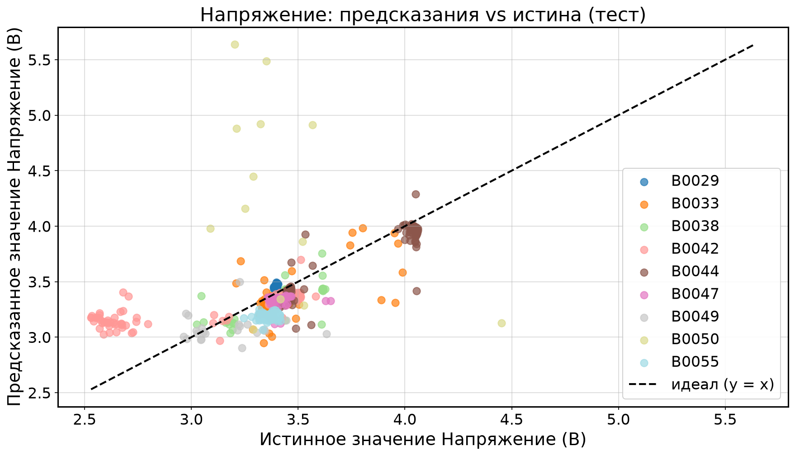
<figcaption>Рис. 5.4 — Напряжение: предсказанные vs истинные значения (тест)</figcaption>
</figure>

**Что на графике.** По оси X — истинное напряжение, по оси Y —
остаток. Пунктир y = 0. Вывод: остатки вокруг нуля, отдельные выбросы —
строки аномальной батареи.

<figure>
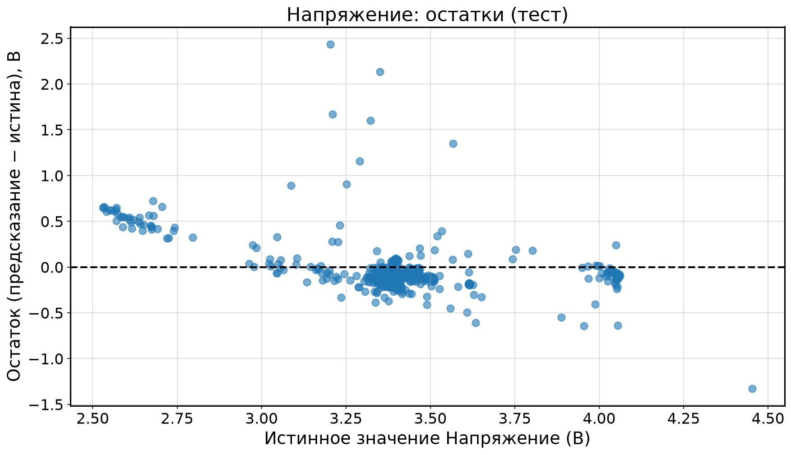
<figcaption>Рис. 5.5 — Остатки модели напряжения (тест)</figcaption>
</figure>

### 5.3. Ёмкость (33 батареи)

| метрика | значение | оценка |
|---|---|---|
| MAE | 0.138128 | устойчивое качество по всей совокупности |
| RMSE | 0.267759 | заметно выше MAE из-за выбросов |
| R² | 0.757734 | высокая объяснённая дисперсия |

Тест: 686 строк, 9 батарей.
B0052 выпала из датасета после честного `dropna` (всего 4 discharge-цикла, не
набирается строка ни с одним полным лагом), поэтому здесь 33 батареи, а не 34.
Худшая батарея теста — B0042 (MAE 0.373 Ahr).

**Что на графике.** По оси X — истинная ёмкость следующего
цикла (Ahr), по оси Y — предсказанная. Цвет — батареи теста. Пунктир — идеал.
Вывод: точки плотно вдоль диагонали; ёмкость даёт высокое качество,
но по R² уступает RUL_frac.

<figure>
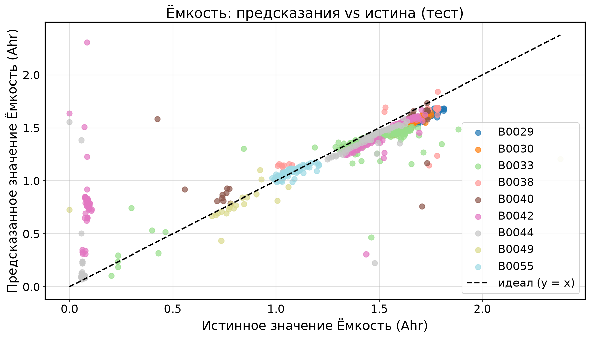
<figcaption>Рис. 5.6 — Ёмкость: предсказания (тест)</figcaption>
</figure>

**Что на графике.** По оси X — истинная ёмкость, по оси Y —
остаток. Пунктир y = 0. Вывод: остатки вокруг нуля, кластер около 0 —
аномальные батареи.

<figure>
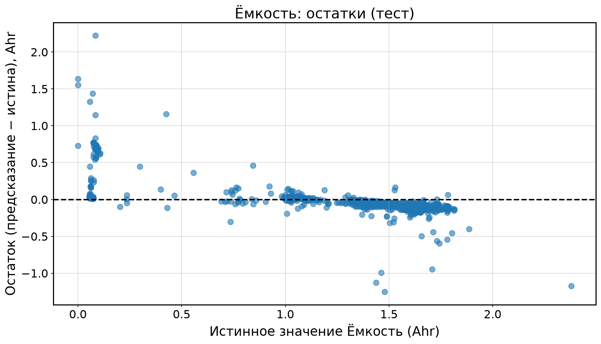
<figcaption>Рис. 5.7 — Остатки модели ёмкости (тест)</figcaption>
</figure>

### 5.4. Сравнение с baseline

**Что такое baseline.** Baseline (базовая модель) — простое предсказание,
с которым сравнивают модель, чтобы отделить вклад архитектуры от вклада самих
признаков. Логика такая: если модель хуже baseline, она бесполезна, и никакая
архитектура этого не оправдывает. Поэтому baseline — не формальность, а рамка
честности.

**Какие baseline использованы.** Три простые модели на том же сплите по
батареям (GroupShuffleSplit, random_state = 42) и с тем же препроцессингом:

- **константа** — среднее значение цели по train-строкам, предсказанное на все
  строки теста;
- **линейная регрессия** (`sklearn.linear_model.LinearRegression`) —
  SimpleImputer(median) + StandardScaler, оба обучены только на train, затем
  линейная модель;
- **Random Forest** (`sklearn.ensemble.RandomForestRegressor`, 100 деревьев,
  random_state = 42) — median-imputer на train; scaler не нужен, древовидная
  модель инвариантна к монотонным преобразованиям.

**Результаты: R² на тесте.** Лучшая модель по каждой задаче выделена жирным.

| задача | MLP | константа | линейная регрессия | Random Forest | лучший |
|--------|-----|-----------|--------------------|---------------|--------|
| A: RUL_frac | **0.8023** | 0.0000 | -2127.86 | -0.7499 | **MLP** |
| B: Напряжение | 0.0481 | -0.0478 | **0.8684** | 0.5711 | **линейная регрессия** |
| C: Ёмкость | 0.7577 | -0.0067 | **0.8424** | 0.7025 | **линейная регрессия** |

**Полная таблица метрик.**

| задача | метод | MAE | RMSE | R² |
|--------|-------|-----|------|-----|
| A: RUL_frac | **MLP** | 0.1089 | 0.1294 | 0.8023 |
| A: RUL_frac | константа | 0.2521 | 0.2911 | 0.0000 |
| A: RUL_frac | линейная регрессия | 11.261 | 13.431 | -2127.86 |
| A: RUL_frac | Random Forest | 0.2800 | 0.3851 | -0.7499 |
| B: Напряжение | **MLP** | 0.1567 | 0.2592 | 0.0481 |
| B: Напряжение | константа | 0.1627 | 0.2719 | -0.0478 |
| B: Напряжение | линейная регрессия | 0.0388 | 0.0964 | 0.8684 |
| B: Напряжение | Random Forest | 0.0742 | 0.1740 | 0.5711 |
| C: Ёмкость | **MLP** | 0.1381 | 0.2678 | 0.7577 |
| C: Ёмкость | константа | 0.4182 | 0.5458 | -0.0067 |
| C: Ёмкость | линейная регрессия | 0.0975 | 0.2159 | 0.8424 |
| C: Ёмкость | Random Forest | 0.1428 | 0.2967 | 0.7025 |

**Что на графике.** Три панели — по одной на задачу. По оси X — четыре модели
(MLP, константа, линейная регрессия, Random Forest), по оси Y — R² на тесте.
Синим выделен MLP, серыми — baseline; пунктир — уровень R² = 0, то есть
качество константного предсказателя. Шкала по Y общая для трёх панелей.
Столбец линейной регрессии на панели A: RUL_frac уходит далеко за её нижний
предел, поэтому он показан зазубренным фрагментом у края и подписан настоящим
значением с пометкой «вне шкалы» — иначе на линейной оси остальные столбцы были
бы неразличимы.

<figure>
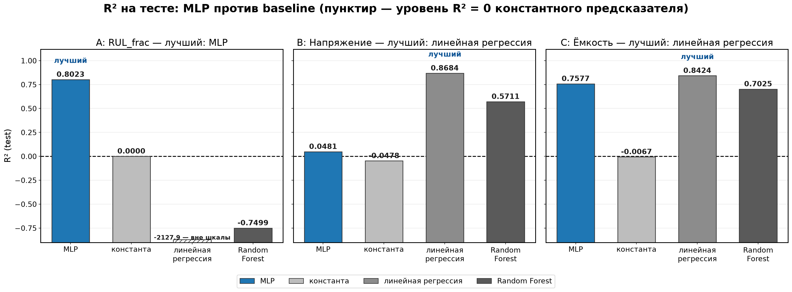
<figcaption>Рис. 5.8 — R² (test): MLP против baseline по трём задачам; MLP — синий, baseline — серые, пунктир — уровень R² = 0</figcaption>
</figure>

**Вывод по задачам — без приукрашивания.**

- **A: RUL_frac — MLP побеждает.** R²(MLP) = 0.8023 против
  0.0000 у константы (константа по построению даёт ровно 0)
  и -0.7499 у Random Forest: на 8 батареях деревья
  переобучаются и оказываются хуже константы. Линейная регрессия здесь
  **ломается об экстраполяцию**: R² = -2127.86, MAE =
  11.261 доли при целях в [0, 1]. Причина: тестовая
  батарея B0006 (167 циклов) длиннее любой серии в обучающей выборке
  (максимум 71 цикл), и линейный прогноз уходит в нефизичную область. MLP —
  единственная модель, удерживающая RUL_frac в осмысленном диапазоне.
- **B: Напряжение — MLP проигрывает линейной регрессии.** R²(MLP) =
  0.0481 (MAE = 0.1567 В) против
  R²(LR) = 0.8684 (MAE = 0.0388 В)
  и R²(RF) = 0.5711. Тот же сплит, тот же препроцессинг — и
  простая линейная модель объясняет 87% дисперсии напряжения следующего цикла
  там, где MLP даёт около нуля. Это важная оговорка к разделу 5.2: низкий R²
  MLP здесь — не «фундаментальная нерешаемость» задачи, а свойство именно этой
  архитектуры на этом наборе.
- **C: Ёмкость — MLP уступает линейной регрессии, но обгоняет Random Forest.**
  R²(MLP) = 0.7577 (MAE = 0.1381 Ahr)
  против R²(LR) = 0.8424 (MAE =
  0.0975 Ahr) и R²(RF) = 0.7025.
  Линейная регрессия снова впереди: цель `capacity_next` сильно коррелирует с
  текущей ёмкостью и её лагами, и линейный предиктор выжимает из этих признаков
  больше, чем MLP.

**Итог.** MLP превосходит все три baseline **только** по RUL_frac. По напряжению
и ёмкости линейная регрессия лучше, Random Forest занимает промежуточное
положение, а константа везде остаётся около нуля (R² ≈ 0 по построению).
Метрики — в `data/processed/summary_baselines.json` (скрипт
`scripts/run_baselines.py`).

## 6. Сравнение

| задача | единица | MAE (test) | RMSE (test) | R² (test) | строк теста | батарей теста |
|--------|---------|------------|-------------|-----------|-------------|----------------|
| A: RUL_frac | доли | 0.108867 | 0.129426 | 0.802316 | 240 | 2 |
| B: Напряжение | В | 0.156747 | 0.259169 | 0.048058 | 696 | 9 |
| C: Ёмкость | Ahr | 0.138128 | 0.267759 | 0.757734 | 686 | 9 |

Цвет: ■ хорошо, ■ средне,
■ плохо. Легенда метрик: MAE/RMSE — в единицах цели
(доли / В / Ahr), R² — безразмерен.

**Что на графике.** Три панели — MAE, RMSE и R²; в каждой три столбца, по одному
на задачу. Под столбцами подписаны значение и единица измерения. Цвет: красный —
RUL_frac, синий — напряжение, зелёный — ёмкость. Панель R² ограничена диапазоном
0–1, поэтому у напряжения (R² = 0.048) столбец почти не виден —
это честная длина шкалы, а не обрезка. Вывод: MAE и RMSE у RUL_frac и ёмкости
сопоставимы, а напряжение отстаёт по объяснённой дисперсии.

<figure>
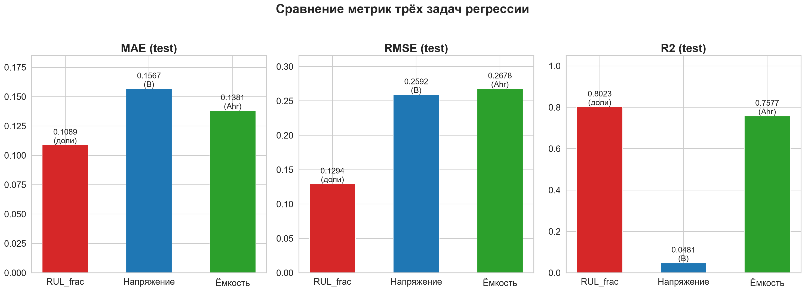
<figcaption>Рис. 6.1 — MAE / RMSE / R² трёх задач (единицы на столбцах)</figcaption>
</figure>

**Что на графике.** По оси X — эпохи, по оси Y — val MAE, нормированный к 0–1
(нормировка нужна, чтобы задачи с разными единицами цели читались на одной оси).
Три кривые: красная — RUL_frac, синяя — напряжение, зелёная — ёмкость; в легенде
указано число эпох, на котором EarlyStopping остановил обучение. Вывод: кривые
val MAE использованы для контроля переобучения, его же числа (train / val / test)
приведены в 7.1.

<figure>
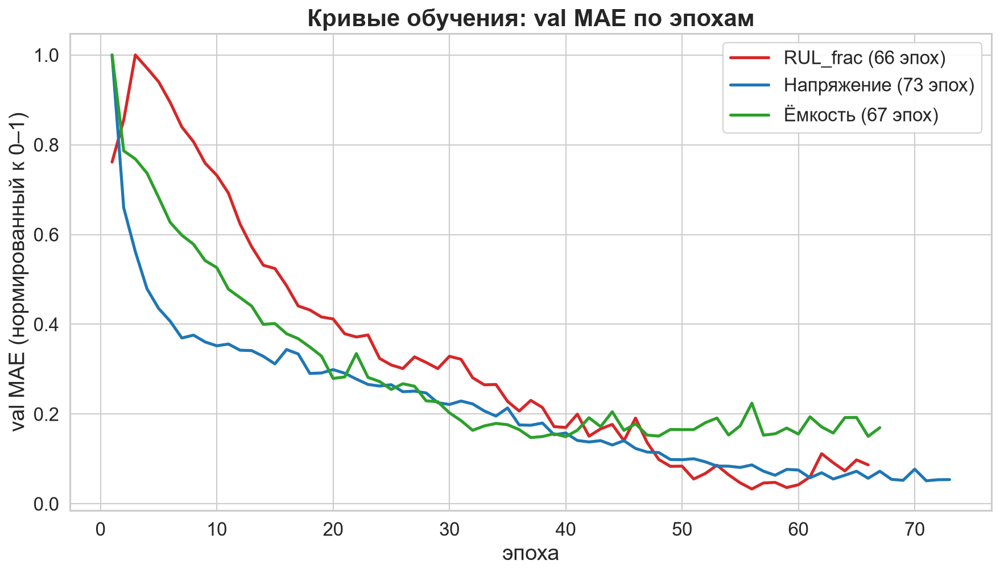
<figcaption>Рис. 6.2 — Кривые обучения: val MAE (нормирован к 0–1) по эпохам</figcaption>
</figure>

## 7. Анализ

### 7.1. RUL_frac: выбор цели и контроль переобучения

**Почему цель нормирована.** Остаточный ресурс в абсолютных циклах зависит от
длины серии: у длинных батарей абсолютный RUL больше, и модель вынуждена
экстраполировать к сериям длиннее обучающих. Нормировка
`RUL_frac = RUL_cycles / total_cycles` приводит цели всех батарей к общему
интервалу [0, 1] и убирает эту зависимость. Полученное качество:
R² = 0.802316 (MAE = 0.108867 доли, то есть около
13.0 цикла) — и это нормированная величина, одинаково
сравнимая для батарей с разной длиной серии.

**Контроль переобучения.** Train MAE = 0.110101,
val MAE = 0.129562, test MAE = 0.108867.
Разрыв train/val ≈ 0.019461
указывает на умеренный обобщающий разрыв, а не на драматичную деградацию;
ранняя остановка и Dropout ограничивают переобучение.

### 7.2. Feature importance (permutation)

**Feature importance (без утечки).** Permutation importance для
RUL_frac пересчитана по out-of-sample схеме: `SimpleImputer`/`StandardScaler` и
сама MLP обучаются **только на train-батареях**
(B0045, B0046, B0048, B0053), а значимость
измеряется перетасовкой признака на 2 **тестовых**
батареях (B0006, B0047), которых модель
никогда не видела (`scoring="r2"`, `n_repeats=5`, базовый R² модели на тесте =
0.80). Топ-3 — `temp_max` (9.17 ± 0.34), `temp_mean` (5.91),
`temp_min` (1.21); далее `current_mean` (0.48), `capacity_ratio` (0.46),
`time_total` (0.29), `voltage_mean` (0.11), `capacity` (0.11),
`discharge_rate` (0.08), `temp_range` (0.06), `voltage_min` (0.02),
`voltage_range` (0.007), `voltage_std` (0.002), `voltage_max` (−0.01).

**Как это читать.** Permutation importance показывает вклад признака в точность
модели на тех батареях, на которых она проверяется. Три температурных признака
дают основной вклад, вклады остальных существенно меньше, `voltage_max` — около
нуля (перетасовка почти не меняет R²). Высокий вклад температурных признаков
означает, что на этом наборе модель опирается прежде всего на условия съёмки,
а не на физику деградации ёмкости, поэтому переносить такой прогноз на батареи с
другими условиями съёмки рискованно.

**Что на графике.** Горизонтальный bar chart: по оси X — снижение R² при
перетасовке признака (mean ± std по 5 повторам), по оси Y — 14 признаков RUL.
Подпись на графике фиксирует схему: fit imputer/scaler/MLP — только на train
(272 строки, 4 батареи),
importance — test (240 строк, 2 батареи,
базовый R² = 0.80).

<figure>
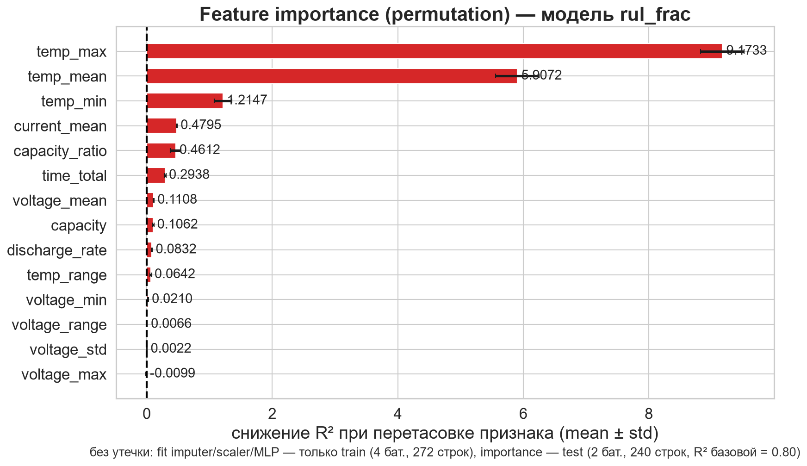
<figcaption>Рис. 7.1 — Permutation importance RUL_frac (fit только на train, подсчёт на тесте)</figcaption>
</figure>

### 7.3. Корреляции признаков с целью

**Корреляции (линейные).** По модулю линейной корреляции с `RUL_frac` главные
предикторы — `capacity_ratio` (r = 0.63) и `capacity` (r = 0.45). Корреляция
измеряет только линейную связь и ничего не говорит о том, использует ли признак
модель, — поэтому картина важности на рис. 7.1 (permutation) отличается от
картины корреляций здесь.

**Что на графике.** Тепловая карта корреляций топ-10 признаков
с целью RUL_frac. Цвет: красный — положительная корреляция, синий —
отрицательная. Числа в клетках — значения r.

<figure>
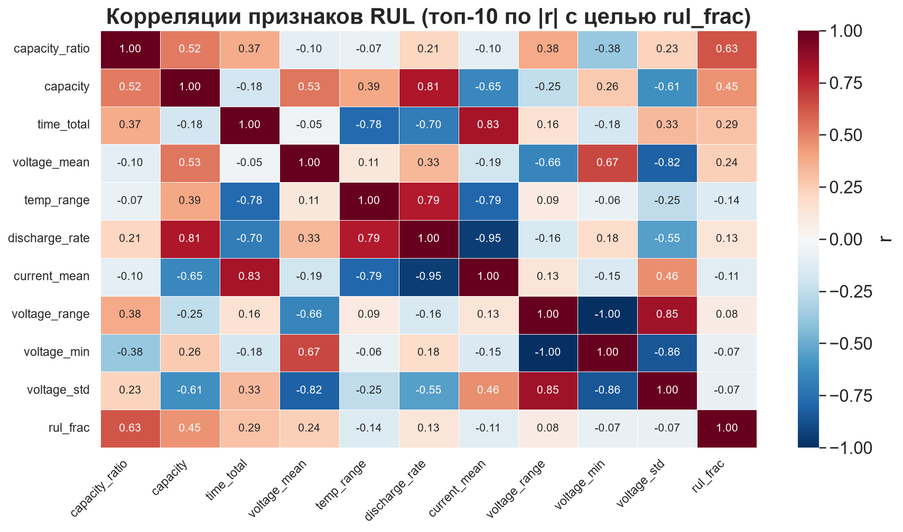
<figcaption>Рис. 7.2 — Корреляции признаков RUL_frac (топ-10 признаков по модулю корреляции с целью)</figcaption>
</figure>

### 7.4. Аномалии данных

**Аномалии — реальные свойства датасета, а не ошибки сбора данных.**

- **B0050** — мусорные/одиночные чтения напряжения в исходных файлах;
  строки нельзя «вылечить» признаками. В тесте напряжения она даёт MAE около
  1.103 В и завышает агрегированные метрики задачи B.
- **B0042–B0044** — короткие серии с немедленным падением ёмкости (EOL на
  ~30-м цикле); участвуют в B/C, но не дают осмысленного RUL.
- **B0052** — всего 4 discharge-цикла: не набирает строк ни с одним полным лагом и
  честно выпадает из датасета C после `dropna` (33 батареи).
- **Ёмкость < 0.5 Ahr** в исходных кривых — сохранена как реальные данные
  деградации (красные точки на рис. 7.3).

**Что на графике.** Кривые деградации аномальных батарей. Красные
точки — циклы с capacity_ratio < 0.5. Вывод: B0033, B0034, B0036, B0039,
B0041 имеют резкие падения ёмкости — реальные аномалии.

<figure>
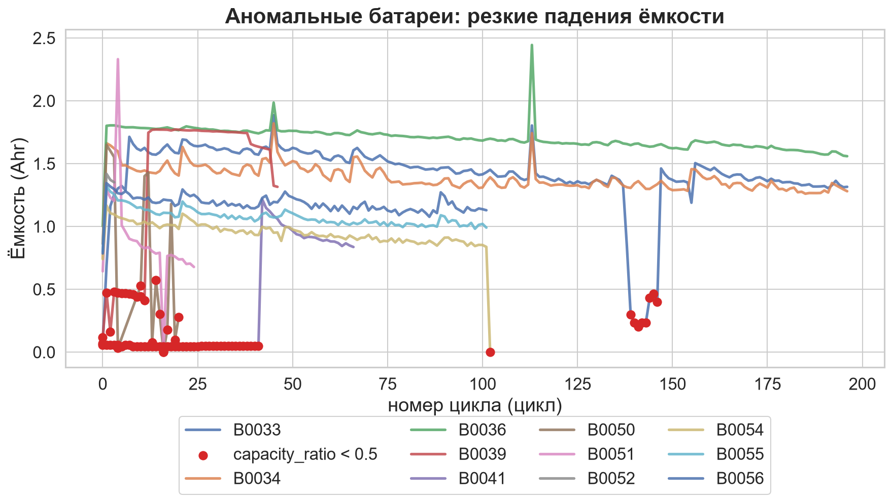
<figcaption>Рис. 7.3 — Аномальные батареи: резкие падения ёмкости (красным цикла с capacity_ratio &lt; 0.5)</figcaption>
</figure>

**Что на графике.** Три панели: RUL_frac, напряжение, ёмкость.
По оси Y — батареи теста, по оси X — MAE. Вывод: для напряжения выброс —
B0050 (1.103 В), для ёмкости — B0042
(0.373 Ahr), для RUL_frac — B0006 и B0047.

<figure>
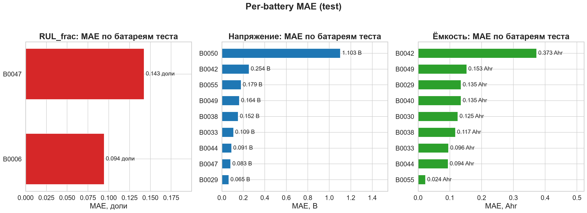
<figcaption>Рис. 7.4 — MAE по батареям теста для трёх задач</figcaption>
</figure>

**Что на графике.** Кривые деградации всех 34 батарей: по оси X —
номер цикла, по оси Y — ёмкость (Ahr). Вывод: видны три типа
кривых — плавное убывание, резкие падения, короткие серии.

<figure>
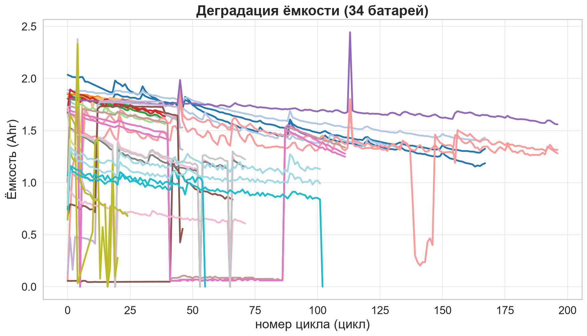
<figcaption>Рис. 7.5 — Кривые деградации всех 34 батарей (ёмкость по циклам)</figcaption>
</figure>

### 7.5. Сравнение с baseline: что из этого следует

Baseline (см. определение в 5.4) — простейшее предсказание, с которым сравнивают
модель; сравнение проведено на том же сплите по батареям для константы, линейной
регрессии и Random Forest. Полные числа — в таблице и на рисунке раздела 5.4,
здесь разбирается смысл результата.

**MLP выигрывает не всегда — и это главный вывод сравнения.**

- **RUL_frac: R² = 0.8023 против 0.0000 у
  константы.** Задача нелинейная (остаточный ресурс зависит от формы кривой
  деградации и длины серии, а не от одного признака) и требует экстраполяции за
  пределы обучающих серий — здесь MLP единственная рабочая модель.
- **Напряжение: R² = 0.0481 у MLP против
  0.8684 у линейной регрессии.** Напряжение следующего
  цикла почти линейно зависит от текущего напряжения и ёмкости; для такой связи
  универсальная сеть не нужна, а лишние параметры мешают.
- **Ёмкость: R² = 0.7577 у MLP против
  0.8424 у линейной регрессии.** Ёмкость следующего цикла
  тоже почти линейно связана с текущей ёмкостью и её лагами, поэтому линейный
  предиктор снова точнее.

**Почему так.** Сложность модели должна соответствовать сложности задачи и
объёму данных. Линейная регрессия на трёх задачах имеет 15 / 14 / 11 параметров
(число признаков плюс сдвиг), MLP — 3073 / 3009 / 2817. При 8–34 батареях в
выборке MLP переобучается, а линейная модель — нет.

**Вывод.** MLP не панацея: на двух задачах из трёх линейная регрессия даёт
лучшее качество, и это не дефект MLP, а точная характеристика задач. Практический
вывод для выбора модели: линейная регрессия — рабочий вариант для напряжения и
ёмкости, MLP оправдан для RUL_frac.

## 8. Ограничения

- Для RUL только 8 батарей: маленькая выборка, тест — 2 батареи (25%);
  оценка метрик сильно зависит от того, какие батареи попали в тест.
- Длина серии известна в датасете заранее, в реальной эксплуатации она
  неизвестна, поэтому MAE ≈ 13.0 цикла — приближённая
  интерпретация нормированной метрики, а не независимая метрика.
- Censored-батареи не имеют EOL по порогу 0.7 · cap0 — их RUL не определён
  (свойство датасета, не пайплайна).
- Задача C обучается на 33 батареях: B0052 выпадает после честного `dropna`.
- Модель табличная, без физики (импеданс, температурные зависимости): признак —
  статистики цикла, а не полные кривые разряда.
- Аномальные батареи (B0050 и др.) остаются в датасетах B/C и ухудшают
  честные метрики.
- MLP переобучается на малой выборке: 8–34 батареи на 2817–3073 параметров, и на
  двух задачах из трёх линейная регрессия с 11–14 параметрами даёт лучшее
  качество (5.4, 7.5).
- Перенос прогноза на батареи с другими условиями съёмки не проверялся: всё
  качество измерено внутри известного набора (7.2).

## 9. Выводы

1. Один MLP-шаблон решает все три задачи регрессии со сплитом строго по
   батареям: RUL — `Input(14)` и 3073 параметра, напряжение — `Input(13)`
   и 3009, ёмкость — `Input(10)` и 2817.
2. **RUL_frac:** MAE = 0.109, RMSE = 0.129,
   R² = 0.802 — нормировка цели на длину серии сняла
   зависимость от длины кривой; в интерпретации это около
   13.0 цикла.
3. **Напряжение:** MAE = 0.157 В, RMSE =
   0.259, R² = 0.048 — низкое объяснение
   дисперсии; аномальная B0050 (MAE 1.103 В против
   0.06–0.25 В у остальных батарей теста) остаётся
   главным источником агрегированной ошибки.
4. **Ёмкость:** MAE = 0.138 Ahr, RMSE =
   0.268, R² = 0.758 — высокое качество
   благодаря сильной связи цели с текущей ёмкостью и её лагами.
5. Все 34 батареи задействованы (RUL — 8 с полной кривой, напряжение — 34,
   ёмкость — 33 после честного dropna); ограничения датасета задокументированы,
   а не скрыты.
6. **Важность признаков:** permutation importance посчитана вне обучающей
   выборки (fit на train, перетасовка на тесте, `scoring="r2"`, `n_repeats=5`):
   топ-3 — `temp_max` (9.17), `temp_mean` (5.91), `temp_min` (1.21), то есть
   прогноз опирается прежде всего на условия съёмки, а не на физику деградации.
7. **Сравнение с baseline: MLP превосходит все baseline только по RUL_frac** (R² = 0.8023 против 0.0000 у константы). По напряжению и ёмкости лучше линейная регрессия: R² = 0.8684 и 0.8424 против 0.0481 и 0.7577 у MLP; Random Forest занимает промежуточное положение. Это говорит о почти линейной природе задач напряжения и ёмкости и о переобучении MLP на малой выборке (см. 5.4, 7.5).

## 10. Приложение

**Схема пайплайна и архитектуры.**

**Что на схеме.** Пайплайн обработки: .mat → parser → clean →
features → 3 датасета → 3 модели → метрики → отчёт.

<figure>
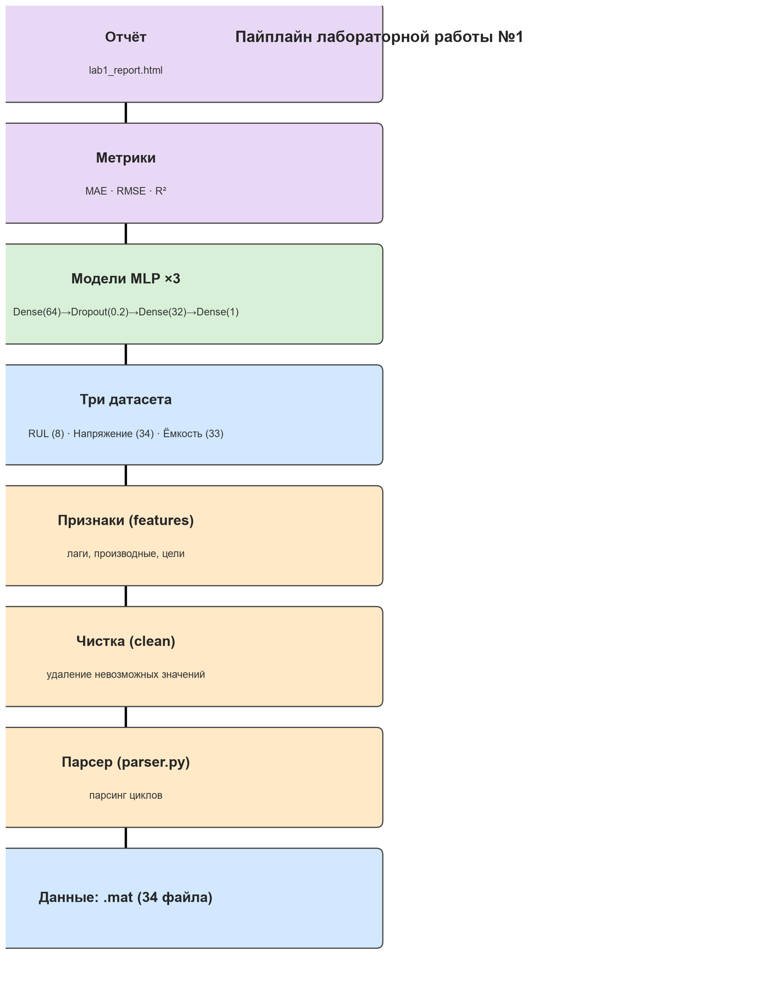
<figcaption>Рис. 10.1 — Пайплайн: .mat → parser → clean → features → 3 датасета → 3 модели → метрики → отчёт</figcaption>
</figure>

**Что на схеме.** Архитектура MLP для RUL: Input(14) → Dense(64, ReLU) →
Dropout(0.2) → Dense(32, ReLU) → Dense(1). Всего 3073 параметра.

<figure>
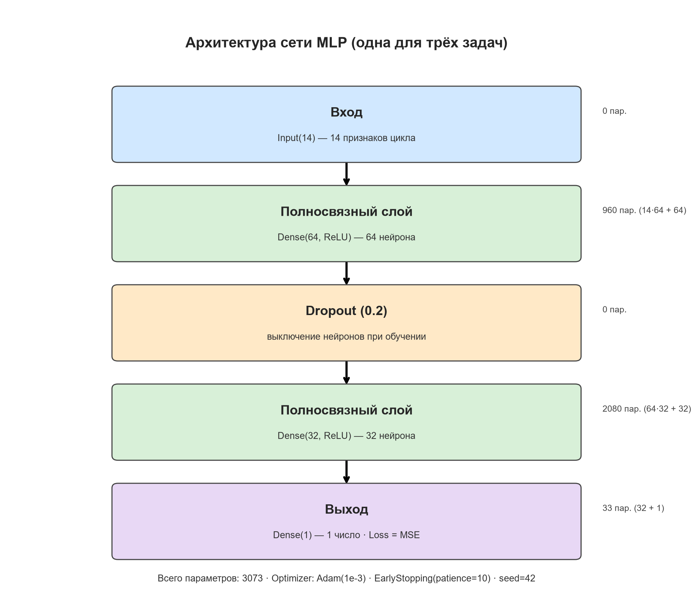
<figcaption>Рис. 10.2 — Архитектура MLP для RUL: Input(14) → Dense(64) → Dropout(0.2) → Dense(32) → Dense(1), 3073 параметра</figcaption>
</figure>

**Что на графике.** Итоговая сводка: метрики трёх задач, предсказания
RUL_frac, деградация ёмкости, кривые обучения.

<figure>
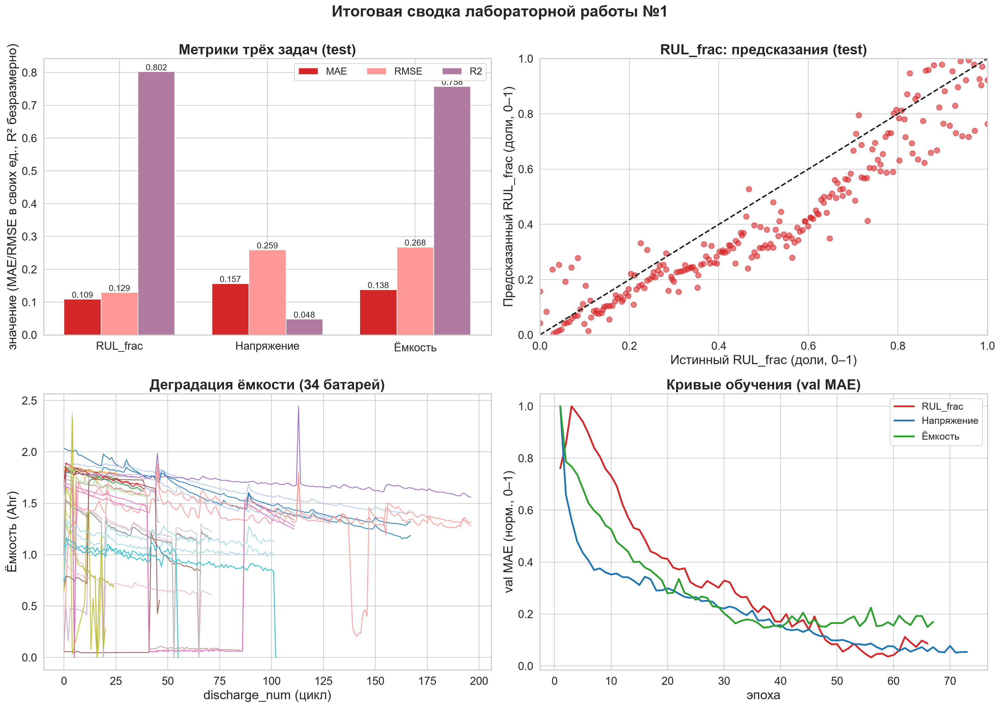
<figcaption>Рис. 10.3 — Итоговая сводка (метрики, предсказания RUL_frac, деградация, кривые обучения)</figcaption>
</figure>

**Выходные файлы пайплайна.**

| файл | содержание |
|---|---|
| `metrics_rul.json` | метрики RUL_frac (train/val/test, per-battery, split) |
| `metrics_voltage.json` / `metrics_capacity.json` | метрики задач B/C |
| `summary_metrics.json` | сводка метрик трёх задач |
| `summary_baselines.json` | метрики MLP, константы, линейной регрессии и Random Forest по трём задачам |
| `comparison_baselines.json` | те же метрики в плоском виде (задача × модель) |
| `battery_rul.parquet` / `battery_voltage.parquet` / `battery_capacity.parquet` | датасеты задач |
| `model_rul.keras` / `model_voltage.keras` / `model_capacity.keras` | обученные модели |
| `battery_features.parquet/csv/xlsx/json` | таблица признаков 34 батарей |
| `../reports/figures/baseline_comparison.png` | R² (test): MLP против baseline по трём задачам |

**Воспроизводимость.** `python scripts/run_all.py` пересобирает весь пайплайн
(парсинг → признаки → обучение → таблицы метрик → графики → HTML-отчёт) с
фиксированными семенами; `python -m pytest tests -q` — 24 теста;
`python scripts/check_leakage.py` — проверка утечек (состав признаков против
чёрного списка колонок, знаки лагов, пересечения сплита, обучение нормализатора
только на train); `python scripts/run_baselines.py` — метрики baseline;
`python scripts/run_baseline_chart.py` — пересборка графика
`baseline_comparison.png` по сохранённым метрикам без повторного обучения.

## 11. Использованные методы

| Метод | Где использовано |
|---|---|
| Обучение с учителем | Все три задачи |
| MLP с прямой передачей сигнала | Dense(64) → Dropout(0.2) → Dense(32) → Dense(1) |
| Функция потерь MSE | Loss модели |
| Метрика MAE | Оценка качества на val/test |
| Обратное распространение ошибки | Обучение в Keras (`model.fit`) |
| Градиентный спуск (Adam) | `optimizer="adam"`, скорость обучения 1e-3 |
| Нормализация входов | StandardScaler, обучение только на train |
| Dropout | Слой Dropout(0.2) |
| Ранняя остановка | EarlyStopping(patience=10, restore_best_weights=True) |
| Permutation importance | Оценка важности признаков RUL_frac |
| Baseline: константа (среднее по train) | Сравнение с MLP в 5.4 |
| Baseline: линейная регрессия | Сравнение с MLP в 5.4 |
| Baseline: Random Forest | Сравнение с MLP в 5.4 |
| Сравнение с baseline | Разделы 5.4 и 7.5 |

**Итог сравнения с baseline.** Линейная регрессия оказалась лучше MLP для задач
напряжения и ёмкости: R² = 0.8684 и
0.8424 против 0.0481 и
0.7577 у MLP. Это указывает на почти линейную природу этих
задач; MLP оправдан только для RUL_frac. Подробный разбор — в 5.4 и 7.5.
